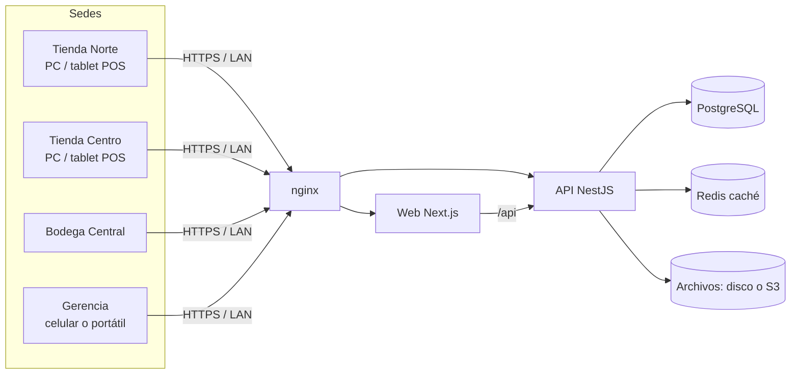
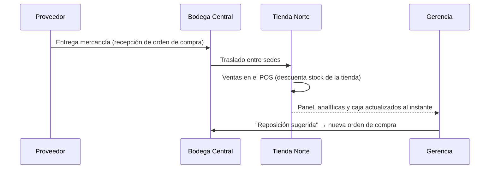

<div align="center">

# Inventario Pro

**Plataforma de inventario, punto de venta y finanzas para negocios con una o muchas sedes.**

Controla existencias, ventas, compras, caja y finanzas de todas tus tiendas y bodegas desde un solo lugar, en tiempo real.

    

**© 2026 JuanPH-M. Todos los derechos reservados.**

</div>

---

## Contenido

1. [¿Qué es Inventario Pro?](#qué-es-inventario-pro)
2. [¿Qué puede hacer?](#qué-puede-hacer)
3. [¿Quién puede usarlo?](#quién-puede-usarlo)
4. [Formas de instalación](#formas-de-instalación)
5. [Requisitos](#requisitos)
6. [Instalación para desarrollo o prueba local](#instalación-para-desarrollo-o-prueba-local)
7. [Instalación en producción con Docker](#instalación-en-producción-con-docker)
8. [Cómo montarlo en una cadena con varias sedes](#cómo-montarlo-en-una-cadena-con-varias-sedes)
9. [Guía de uso del día a día](#guía-de-uso-del-día-a-día)
10. [Cómo funciona por dentro](#cómo-funciona-por-dentro)
11. [Seguridad](#seguridad)
12. [Copias de seguridad y recuperación](#copias-de-seguridad-y-recuperación)
13. [Variables de configuración](#variables-de-configuración)
14. [Pruebas y calidad](#pruebas-y-calidad)
15. [Estructura del proyecto](#estructura-del-proyecto)
16. [Solución de problemas](#solución-de-problemas)
17. [Licencia y derechos de autor](#licencia-y-derechos-de-autor)

---

## ¿Qué es Inventario Pro?

Inventario Pro es un sistema web empresarial (se usa desde el navegador, sin instalar nada en cada equipo) que centraliza la operación de un negocio de venta de productos:

- **Cada sede** (tienda, punto de venta o bodega) registra sus ventas, recibe mercancía y maneja su propia caja.
- **La gerencia** ve en tiempo real cuánto vende cada sede, qué productos se están agotando, cuánto dinero hay en inventario y cuál es la utilidad.
- **Toda la información vive en un único servidor central**: cuando la tienda de un barrio vende, el inventario y los reportes de la oficina principal se actualizan al instante.

Puede usarse en **una sola tienda** o en una **cadena con decenas de sedes**, en la **nube** o en un **servidor propio dentro de la empresa**.

---

## ¿Qué puede hacer?

### Venta y caja
| Función | Descripción |
|---|---|
| **Punto de venta (POS)** | Pantalla táctil y de teclado para vender rápido: búsqueda, **lector de código de barras**, categorías, carrito, cálculo de IVA incluido o adicional, descuentos, pagos en efectivo con cálculo de cambio, tarjeta, transferencia o **crédito**. Atajos F2 (buscar) y F9 (cobrar). |
| **Comprobante imprimible** | Tirilla de 80 mm lista para impresora térmica o impresión normal. |
| **Ventas** | Historial filtrable por fecha, estado y sede; detalle con comprobante; exportación a Excel. |
| **Anulaciones seguras** | Anular una venta devuelve automáticamente las unidades al inventario y reversa el ingreso y el efectivo de caja, todo en una sola operación auditada. |
| **Caja registradora** | Apertura con base, movimientos (ingresos, retiros, gastos), cierre con arqueo y diferencia. Las ventas en efectivo entran solas a la caja abierta de la sede. |
| **Cotizaciones** | Ventas tipo cotización que no afectan inventario ni caja. |

### Inventario multisede
| Función | Descripción |
|---|---|
| **Existencias por sede** | Matriz producto × sede con alertas de stock bajo y agotado. |
| **Kardex** | Historial completo de cada unidad: compras, ventas, traslados, ajustes, devoluciones, con saldo y responsable. |
| **Traslados entre sedes** | Mueve mercancía de la bodega a una tienda (o entre tiendas) en una operación atómica. |
| **Ajustes** | Entradas, mermas, daños, robos, reparaciones e inventario inicial, siempre con justificación. |
| **Productos y categorías** | Catálogo con códigos internos, códigos de barras, QR, imágenes, precios mínimos, impuestos e historial de cambios. |
| **Costo promedio ponderado** | Cada recepción de compra recalcula el costo del producto automáticamente. |

### Compras y proveedores
- Órdenes de compra con flujo **borrador → aprobada → enviada → recibida (parcial o total)**.
- La recepción suma el inventario en la sede destino y no permite recibir más de lo pedido.
- Directorio de proveedores con condiciones de pago.

### Finanzas, reportes e inteligencia
| Función | Descripción |
|---|---|
| **Panel principal** | Ingresos, ventas, ticket promedio y **utilidad bruta** con variación frente al periodo anterior, tendencia diaria, medios de pago, rendimiento por sede, productos estrella, valor del inventario y últimas ventas. |
| **Analíticas** | Comparativo de sedes, margen bruto, impuestos recaudados, descuentos, compras, de 7 días a 1 año. |
| **Finanzas** | Ingresos y egresos por sede, resultado neto y registro de gastos (arriendo, nómina, servicios). |
| **Reportes** | Ventas, inventario, compras, finanzas, clientes y productos en **PDF, Excel o CSV**. |
| **Inteligencia** | Pronóstico de agotamiento por producto y sede según el ritmo real de ventas, **cantidad sugerida a pedir**, detección de inventario sin movimiento, tendencias de ventas y un **asistente conversacional** que responde preguntas sobre el negocio (usa Claude si se configura una clave; si no, funciona con reglas y sin internet). |
| **Alertas automáticas** | Cada mañana se notifica a los responsables de inventario qué productos necesitan reposición. |

### Administración
- **Usuarios y roles por sede**: una misma persona puede ser *Gerente* en una tienda y *Vendedor* en otra.
- 8 roles predefinidos (Administrador general, Administrador de sucursal, Supervisor, Encargado de inventario, Vendedor, Empleado, Auditor) con **137 permisos granulares**.
- **Auditoría** de todas las acciones (quién, qué, cuándo, desde qué IP).
- **Copias de seguridad** manuales y automáticas descargables.
- Clientes (CRM), documentos, activos fijos con mantenimientos, incidencias internas, calendario, suscripciones, divisas.
- Tema claro/oscuro, búsqueda global con **Ctrl + K**, diseño adaptable a computador, tablet y celular.

---

## ¿Quién puede usarlo?

Está pensado para cualquier negocio que **compra, almacena y vende productos**, especialmente si tiene varias sedes:

| Tipo de negocio | Cómo lo aprovecha |
|---|---|
| **Cadenas de tiendas y minimercados** | Bodega central que abastece a varias tiendas con traslados; ventas y caja por tienda; comparativo de sedes. |
| **Tiendas de ropa, calzado y accesorios** | Control por referencia, temporadas, productos sin rotación para promociones. |
| **Ferreterías y almacenes de construcción** | Catálogos grandes con código de barras, compras a muchos proveedores, ventas a crédito. |
| **Droguerías y tiendas naturistas** | Stock mínimo, alertas de reposición, varias sedes en la ciudad. |
| **Tiendas de tecnología y electrodomésticos** | Productos de alto valor, costos promedio, auditoría estricta. |
| **Joyerías** | Ficha técnica de joyería en la API (quilataje, piedras, certificados), productos de alto valor y control fino de inventario. |
| **Distribuidoras y mayoristas** | Bodegas, órdenes de compra, clientes con crédito, reportes de utilidad. |
| **Papelerías, librerías, tiendas de mascotas, licoreras, panaderías con productos de reventa** | POS rápido y control de existencias. |
| **Franquicias** | Cada franquicia es una sede con sus usuarios; la casa matriz ve todo consolidado. |

> **También para una sola tienda**: funciona igual con una sede; si luego abres más, solo creas las nuevas sedes.
>
> **Multiempresa (SaaS)**: un mismo servidor puede atender a varias empresas totalmente aisladas entre sí, por lo que también sirve para ofrecerlo como servicio.

---

## Formas de instalación

| Modalidad | Para quién | Cómo se conectan las sedes |
|---|---|---|
| **1. Local en un equipo** | Una tienda, o para probar | Se abre en `http://localhost` desde el mismo equipo. |
| **2. Servidor en la red local (LAN)** | Una sede grande o varias sedes en el mismo edificio/conjunto | Todos los equipos de la red entran por la IP del servidor, p. ej. `http://192.168.1.50`. **No necesita internet** para vender. |
| **3. Servidor en la nube** (recomendado para cadenas) | Cadenas con sedes en distintos barrios o ciudades | Cada sede entra por internet a `https://inventario.tuempresa.com`. Solo se necesita un servidor. |
| **4. Servidor propio + VPN** | Empresas que quieren los datos en sus instalaciones | El servidor está en la oficina principal; las sedes se conectan por VPN (WireGuard, OpenVPN, Tailscale, ZeroTier) o publicando el puerto con HTTPS. |

En **todas** las modalidades hay **un solo servidor y una sola base de datos**; las sedes no guardan datos propios, por eso todo queda conectado y sincronizado al instante.



---

## Requisitos

### Servidor
| Escenario | CPU | RAM | Disco | Sistema |
|---|---|---|---|---|
| 1 a 3 sedes | 2 núcleos | 4 GB | 20 GB SSD | Linux (Ubuntu 22.04+), Windows 10/11 o macOS |
| 4 a 15 sedes | 4 núcleos | 8 GB | 50 GB SSD | Linux recomendado |
| 15+ sedes | 8 núcleos | 16 GB | 100 GB SSD | Linux + base de datos gestionada |

Software del servidor:
- **Opción A (recomendada)**: [Docker](https://docs.docker.com/get-docker/) y Docker Compose. No necesitas instalar nada más.
- **Opción B (manual)**: [Node.js 20+](https://nodejs.org), [pnpm 9+](https://pnpm.io), [PostgreSQL 16+](https://www.postgresql.org/download/). [Redis 7](https://redis.io) es **opcional** (sin Redis el sistema usa caché en memoria).

### Puestos de trabajo (cada sede)
- Cualquier equipo con navegador moderno: Chrome, Edge, Firefox o Safari (computador, tablet o celular).
- Conexión al servidor (red local o internet; 2 Mbps por sede son suficientes).
- Opcional: **lector de código de barras USB** (funciona como teclado, no requiere configuración) e **impresora de tirilla de 80 mm**.

---

## Instalación para desarrollo o prueba local

> ⚠️ En Windows clona el proyecto **fuera de OneDrive/Dropbox** (por ejemplo `C:\proyectos\inventario`). La sincronización de esas carpetas bloquea archivos que Next.js necesita.

```bash
# 1. Clonar e instalar dependencias
git clone https://github.com/JuanPH-M/INVENTARIO.git
cd INVENTARIO
pnpm install

# 2. (Opcional) Levantar PostgreSQL, Redis y Mailhog con Docker
docker compose -f docker-compose.dev.yml up -d

# 3. Configurar la API y la web
cp apps/api/.env.example apps/api/.env
cp apps/web/.env.example apps/web/.env.local
# edita apps/api/.env → DATABASE_URL con tu PostgreSQL

# 4. Crear la base de datos y cargar datos de demostración
pnpm db:generate
pnpm db:migrate:prod
pnpm db:seed

# 5. Iniciar API (3001) y web (3000)
pnpm dev
```

Abre **http://localhost:3000** e ingresa con una cuenta de demostración:

| Rol | Correo | Contraseña |
|---|---|---|
| Administrador general | `admin@empresa.com` | `Demo123!` |
| Vendedor | `vendedor@empresa.com` | `Demo123!` |
| Supervisor | `supervisor@empresa.com` | `Demo123!` |
| Super administrador de la plataforma | `admin@inventario.dev` | `Admin123!` |

La empresa demo trae **3 tiendas + 1 bodega central, 22 productos, 18 clientes y 60 días de ventas** (~1.000 ventas) para explorar el panel, las analíticas y los pronósticos.

| Servicio | URL |
|---|---|
| Aplicación | http://localhost:3000 |
| API | http://localhost:3001/api |
| Documentación interactiva de la API (Swagger) | http://localhost:3001/api/docs |
| Correos de prueba (Mailhog) | http://localhost:8025 |
| Explorador de base de datos | `pnpm db:studio` |

---

## Instalación en producción con Docker

```bash
git clone https://github.com/JuanPH-M/INVENTARIO.git
cd INVENTARIO
cp .env.example .env
```

Edita `.env` y completa como mínimo:

1. `POSTGRES_PASSWORD` y `REDIS_PASSWORD`: contraseñas largas.
2. `WEB_URL`: la dirección con la que entrarán los usuarios (`http://192.168.1.50` o `https://inventario.tuempresa.com`).
3. `JWT_PRIVATE_KEY` / `JWT_PUBLIC_KEY`: genera el par de claves:
   ```bash
   openssl genrsa -out private.pem 2048
   openssl rsa -in private.pem -pubout -out public.pem
   # Pega cada archivo en una sola línea reemplazando los saltos de línea por \n
   ```
4. `ENCRYPTION_KEY`: `openssl rand -hex 32`
5. `INITIAL_COMPANY_NAME`, `INITIAL_ADMIN_EMAIL` e `INITIAL_ADMIN_PASSWORD`: tu empresa y su primer administrador.

```bash
docker compose up -d --build
```

En el primer arranque el contenedor de la API aplica las migraciones, carga planes, divisas, permisos y roles, y crea tu empresa con su administrador. Entra a `WEB_URL` con ese correo y contraseña.

**HTTPS**: si usas un dominio, coloca `fullchain.pem` y `privkey.pem` (por ejemplo de Let's Encrypt) en `nginx/ssl/`, descomenta el bloque 443 de `nginx/nginx.conf` y pon `COOKIE_SECURE=true`.

**Actualizar a una nueva versión**:
```bash
git pull && docker compose up -d --build   # las migraciones se aplican solas
```

---

## Cómo montarlo en una cadena con varias sedes

Ejemplo: **"Supermercados La Esquina"**, con una bodega central y cuatro tiendas en dos ciudades.

### 1. Elegir dónde vivirá el servidor
- **Recomendado**: un servidor en la nube (AWS Lightsail, DigitalOcean, Azure, Google Cloud, un VPS local) con Docker. Cada tienda solo necesita internet.
- **Alternativa**: un equipo dedicado en la oficina principal + VPN hacia las tiendas (por ejemplo **Tailscale**, que no requiere configurar el router).

Instala con la guía de [producción con Docker](#instalación-en-producción-con-docker).

### 2. Configurar la empresa (como Administrador general)
1. **Configuración**: nombre comercial, razón social, NIT, moneda y datos de contacto.
2. **Sucursales** → crea cada sede: `Bodega Central` (tipo bodega), `Tienda Norte`, `Tienda Sur`, `Tienda Medellín`…
3. **Caja** → crea al menos una caja por tienda (`CAJA-01`, `CAJA-02`).
4. **Categorías** y **Proveedores**.
5. **Productos**, con código de barras, precio, costo, IVA y stock mínimo.

### 3. Crear el equipo de trabajo
En **Usuarios**, crea a cada persona y asígnale un rol **por sede**:

| Persona | Rol | Alcance |
|---|---|---|
| Gerente general | Administrador general | Todas las sedes |
| Jefe de bodega | Encargado de inventario | Bodega Central |
| Administrador de tienda | Administrador de sucursal | Su tienda |
| Cajeros | Vendedor | Su tienda |
| Contador | Auditor | Todas las sedes (solo lectura) |

### 4. Cargar el inventario inicial
- Lo ideal: una **orden de compra** por sede y registrar su **recepción** (deja trazabilidad y costo).
- O desde **Existencias → Ajuste → Inventario inicial**.

### 5. Operación diaria conectada


- **Las tiendas venden** en el POS; el stock que se descuenta es el de su sede.
- **La bodega abastece** con traslados; ambas sedes se actualizan en una sola operación.
- **La gerencia** filtra el panel por sede (selector en la barra superior) o ve el consolidado.
- **Cada mañana** el sistema avisa qué productos se agotarán según el ritmo de ventas.
- **Cada noche** se genera una copia de seguridad automática.

---

## Guía de uso del día a día

| Tarea | Dónde |
|---|---|
| Abrir caja al iniciar el turno | **Caja** → elegir caja → *Abrir caja* con la base |
| Vender | **Punto de venta**: escanear o buscar → *Cobrar* (F9) → imprimir comprobante |
| Anular una venta | **Ventas** → abrir la venta → *Anular* (requiere permiso) |
| Recibir mercancía | **Compras** → orden → *Recibir todo* o cantidades parciales → *Registrar recepción* |
| Pasar mercancía entre sedes | **Existencias** → *Traslado* |
| Registrar una merma o daño | **Existencias** → *Ajuste* |
| Saber qué pedir | **Inteligencia** o tarjeta *Reposición sugerida* del panel |
| Registrar un gasto (arriendo, nómina) | **Finanzas** → *Registrar gasto* |
| Cerrar caja | **Caja** → *Cerrar* con el conteo real; el sistema calcula la diferencia |
| Reporte mensual | **Reportes** → tipo, fechas y formato (PDF/Excel/CSV) |
| Buscar cualquier cosa | `Ctrl + K` |

---

## Cómo funciona por dentro

### Arquitectura
Monorepo con **pnpm workspaces + Turborepo**:

| Paquete | Tecnología | Función |
|---|---|---|
| `apps/api` | NestJS 11, Prisma 6, PostgreSQL 16, Redis 7 | API REST con 28 módulos de negocio |
| `apps/web` | Next.js 15 (App Router), React 19, TanStack Query, Zustand, Tailwind CSS, Radix UI, Recharts | Interfaz web |
| `packages/shared` | TypeScript | Permisos, roles, utilidades compartidas |
| `packages/types` | TypeScript | Tipos compartidos entre API y web |

### Recorrido de una petición
1. El navegador llama a `/api/...` en la **misma dirección de la web**; Next.js (o nginx) la reenvía a la API. Así la cookie de sesión es de primer origen y no hace falta CORS.
2. La API aplica, en orden: **autenticación JWT** → **límite de peticiones** → **roles** → **permisos** del endpoint → **validación** del cuerpo (DTOs con class-validator; errores 422 con detalle por campo).
3. El caso de uso ejecuta la lógica dentro de **transacciones** de base de datos.
4. Un interceptor envuelve la respuesta (`{ success, data }`) y otro registra la **auditoría** de toda operación de escritura.
5. Un filtro global da a todos los errores la misma forma (`{ success: false, statusCode, message, errors? }`).

### Multiempresa y multisede
- Todas las tablas de negocio llevan `tenantId`; cada consulta se filtra por la empresa del usuario autenticado, y las referencias (cliente, proveedor, sucursal, producto, caja) se validan contra esa empresa antes de usarse.
- Las existencias se guardan por **(empresa, producto, sede)**. Las ventas descuentan de la sede que vende; los traslados mueven entre sedes; las compras ingresan a la sede destino.
- Los roles se asignan **globalmente o por sede**, y los permisos efectivos (roles + excepciones individuales) se calculan en un único servicio que usan tanto el backend como el menú de la web.

### Consistencia del inventario
- Cada salida usa una actualización **condicionada y atómica** (`quantity - reserved >= cantidad`): dos cajeros no pueden vender la última unidad al mismo tiempo.
- Venta, descuento de stock, kardex, ingreso financiero y movimiento de caja ocurren en **una sola transacción**: o se guarda todo o nada.
- La numeración de ventas y órdenes es secuencial por año y se reintenta automáticamente ante colisiones.
- El dinero se redondea a centavos con una única función que comparten el POS y la API, para que lo que ve el cajero coincida exactamente con lo registrado.

### Caché y tareas programadas
- Redis guarda permisos, listados y analíticas por pocos segundos o minutos, y la caché se invalida con cada venta, compra o ajuste. Si Redis no está disponible, el sistema sigue funcionando con caché en memoria.
- Tareas automáticas: alertas de reposición (7:00), copias de seguridad (2:00) y limpieza de sesiones vencidas (cada hora).

### Inteligencia
El pronóstico usa las salidas por venta de los últimos 30 días por producto y sede: **demanda diaria promedio → días hasta agotarse → cantidad sugerida** para cubrir el tiempo de entrega del proveedor (7 días) más 14 días de cobertura, con un nivel de confianza según la cantidad de datos. El asistente responde con esos mismos datos; con `ANTHROPIC_API_KEY` usa Claude para respuestas en lenguaje natural.

---

## Seguridad

- **Contraseñas** con Argon2id; política de mínimo 8 caracteres con mayúsculas, minúsculas y números.
- **Sesiones**: access token JWT **RS256** de 15 minutos guardado solo en memoria (nunca en `localStorage`), y refresh token en **cookie HttpOnly, SameSite=Strict**, restringida a `/api/auth`, **rotada** en cada uso y con **detección de robo** (si se reutiliza un token revocado se cierran todas las sesiones).
- **Cierre de sesión real**: revoca el refresh token y pone el access token en lista negra (también si Redis cae).
- **Doble factor (TOTP)** con códigos de respaldo, secreto cifrado con AES-256-GCM y límite de intentos.
- **Bloqueo** de cuenta tras 5 intentos fallidos, rate limiting en la API y en nginx.
- **Recuperación de contraseña** por correo con token de un solo uso guardado como hash, que vence en 60 minutos.
- **Política de roles**: solo un administrador general puede crear otros administradores, y solo un super administrador puede otorgar acceso a la plataforma.
- **Archivos**: validación de tipo, extensión y tamaño; descargas con **URLs firmadas que vencen**; protección contra path traversal.
- Cabeceras de seguridad (Helmet), CORS restringido, auditoría completa y Swagger deshabilitado en producción.

---

## Copias de seguridad y recuperación

- **Desde la aplicación**: *Administración → Copias de seguridad → Crear copia ahora*. Genera un archivo `.json.gz` con todas las tablas de la empresa (sin contraseñas ni secretos) y su huella **SHA-256**. Con `BACKUP_SCHEDULE_ENABLED=true` se genera una copia cada noche.
- **Copia completa del servidor** (recomendada además de la anterior):
  ```bash
  docker compose exec postgres pg_dump -U inventario inventario | gzip > respaldo-$(date +%F).sql.gz
  ```
- **Restaurar** la base completa:
  ```bash
  gunzip -c respaldo-AAAA-MM-DD.sql.gz | docker compose exec -T postgres psql -U inventario inventario
  ```
- Guarda las copias **fuera del servidor** (otro disco, nube o NAS).

---

## Variables de configuración

| Variable | Descripción | Por defecto |
|---|---|---|
| `DATABASE_URL` | Conexión a PostgreSQL | — |
| `REDIS_URL` | Conexión a Redis (opcional) | `redis://localhost:6379` |
| `WEB_URL` | URL(s) públicas de la web, separadas por coma | `http://localhost:3000` |
| `JWT_PRIVATE_KEY` / `JWT_PUBLIC_KEY` | Claves RSA para firmar sesiones (obligatorias en producción) | — |
| `JWT_EXPIRES_IN` / `REFRESH_TOKEN_EXPIRES_IN` | Duración del access y refresh token | `15m` / `7d` |
| `ENCRYPTION_KEY` | 64 hex para cifrar secretos MFA y firmar descargas | — |
| `COOKIE_SECURE` | `true` si se sirve por HTTPS | automático |
| `INITIAL_*` | Empresa y administrador del primer arranque | — |
| `SMTP_*` | Servidor de correo para recuperar contraseñas | — |
| `STORAGE_DRIVER` | `local` o `s3` (S3, MinIO, R2, Spaces) | `local` |
| `TZ` | Zona horaria del negocio | `America/Bogota` |
| `JOBS_ENABLED` | Activa las tareas programadas (solo en una instancia) | `true` |
| `BACKUP_SCHEDULE_ENABLED` | Copia de seguridad nocturna automática | `false` |
| `ANTHROPIC_API_KEY` / `AI_MODEL` | Asistente con Claude (opcional) | — / `claude-opus-5-5` |
| `RATE_LIMIT_MAX` | Peticiones por minuto por IP | `300` |

La lista completa con comentarios está en [`.env.example`](.env.example) (producción) y [`apps/api/.env.example`](apps/api/.env.example) (desarrollo).

---

## Pruebas y calidad

| Suite | Comando | Cobertura |
|---|---|---|
| Unitarias API (Jest) | `pnpm --filter @inventario/api test` | Autenticación, sesiones, ventas, compras, inventario, usuarios y política de roles |
| Unitarias web (Vitest) | `pnpm --filter @inventario/web test` | Login, sesión, cálculo del POS, componentes |
| End-to-end (Jest + Supertest + PostgreSQL real) | `pnpm test:e2e` | Login y cookies, refresh y robo de token, permisos, traslados, POS, anulación, compras, analíticas y backups |
| Tipos | `pnpm typecheck` | Todo el monorepo en modo estricto |

Las pruebas e2e usan una base de datos separada terminada en `_test` (se crea sola a partir de `DATABASE_URL`, o define `TEST_DATABASE_URL`). La integración continua (`.github/workflows/ci.yml`) ejecuta todo en cada cambio.

---

## Estructura del proyecto

```
INVENTARIO/
├── apps/
│   ├── api/                         API NestJS
│   │   ├── prisma/                  Esquema (48 modelos), migraciones y seeds
│   │   ├── src/
│   │   │   ├── modules/             Módulos de negocio (auth, sales, inventory, purchases, ai, jobs…)
│   │   │   ├── common/              Guards, filtros, interceptores, permisos efectivos
│   │   │   ├── cache/  storage/  mail/
│   │   │   └── configure-app.ts     Configuración HTTP compartida (servidor y pruebas)
│   │   └── test/                    Pruebas end-to-end
│   └── web/                         Web Next.js
│       └── src/
│           ├── app/(auth)           Login, recuperación de contraseña
│           ├── app/(dashboard)      Panel y módulos
│           ├── components/          Sistema de diseño, gráficas, layout, POS
│           ├── config/              Marca y navegación
│           └── hooks/ lib/ stores/  Datos, cálculos y estado
├── packages/shared, packages/types  Código compartido
├── nginx/                           Proxy inverso
├── docker-compose.yml               Producción
└── docker-compose.dev.yml           Servicios de desarrollo
```

---

## Solución de problemas

| Problema | Solución |
|---|---|
| La web se queda en "Cargando…" o redirige al login | Verifica que la API responda en `http://localhost:3001/health` y que `API_INTERNAL_URL` apunte a ella. |
| Error `EINVAL readlink` o `EPERM symlink` en Windows | Mueve el proyecto fuera de OneDrive/Dropbox y borra `apps/web/.next`. |
| `Redis unavailable, using in-memory cache` | Es un aviso: el sistema funciona sin Redis. Para varias instancias de la API, Redis es necesario. |
| No llegan los correos de recuperación | Configura `SMTP_*`. En desarrollo el enlace se imprime en la consola de la API. |
| "Este email pertenece a varias empresas" | Escribe el código de la empresa en el campo que aparece en el login. |
| Una sede no puede entrar por la red local | Usa la IP del servidor en `WEB_URL` y abre el puerto 80 en el firewall del servidor. |

---

## Licencia y derechos de autor

**© 2026 JuanPH-M. Todos los derechos reservados.**

Este es **software propietario**. El código se publica únicamente para consulta; **no** se concede permiso para usarlo comercialmente, copiarlo, modificarlo, redistribuirlo ni ofrecerlo como servicio sin autorización escrita del autor. El aviso de derechos de autor que aparece en la parte inferior de la aplicación forma parte de las condiciones de uso y no debe eliminarse. Consulta el archivo [LICENSE](LICENSE).

Para licencias comerciales o implementaciones en tu empresa, contacta a través de [github.com/JuanPH-M](https://github.com/JuanPH-M).
